<div align="center">

# SIDE PROJECT LAB

### Small experiments. Working code. Honest limitations.


[Project index](#project-index) · [Implementation notes](#project-notes) · [Reflections](#technical-reflections) · [Attribution](THIRD_PARTY_NOTICES.md)

**English** · [한국어](README.ko.md)

</div>

---

A collection of side projects inspired by everyday friction and personal interests. This portfolio documents what I attempted, what exists in code, and what still needs work—including experiments that never became finished products.

> **Evidence boundary:** Based on local source files and development records reviewed on October 19, 2026. “Implemented” means code is present; it does not imply production readiness or successful end-to-end operation. The portfolio cleanup did not rerun every application.

## A month with Codex

I spent September 2026 using Codex. The animation below reconstructs the color pattern in my token-activity screenshot; it is a visual record of usage, not a token-count report or a measure of productivity.



[Static version](assets/codex-september-static.svg) · [Visual source data](data/codex-activity-visual.json)

## Project index

| Project | Stack | Focus |
|---|---|---|
| [Mobility Guide](projects/mobility-guide/) | Swift · SwiftUI · Python | Explore walking routes that account for different mobility needs. |
| [Music Separation & Transcription](projects/music-paper/) | Python · Flask · Demucs | Reduce the work involved in separating accompaniment, shifting pitch, and transcribing music. |
| [X Cleaner](projects/x-cleaner/) | Python · React · Node.js | Let users clean up only the posts and reposts they explicitly select. |
| [Timetable Wizard](projects/school-timetable/) | React · TypeScript · Vite | Generate and compare conflict-free schedules from course information. |
| [Korean Radio](projects/radio/) | Swift · SwiftUI · AVPlayer | Explore radio stations through an analog-tuner-inspired interface. |
| [Dev Desk](projects/dev-desk/) | SwiftUI · Charts · IOKit | Bring development instructions, tool activity, and device information into one desktop view. |
| [My Inconveniences](projects/my-inconveniences/) | Go · Bubble Tea · Lip Gloss | Control parts of a development environment and inspect system status from the terminal. |
| [Crisis Indicator Experiment](projects/korea-crisis-watch-ai/) | React · TypeScript · Gemini | Explore economic indicators and AI-generated summaries in a single interface. |
| [1,474,560-Byte Game Experiment](projects/life-in-144mb/) | C · raylib · Python | Explore memory and life through games designed around a small executable-size target. |

## Project notes

### Mobility Guide

**Goal** — Explore walking routes that account for different mobility needs.

**Implementation** — Implemented walking-network import tools, A* routing, stair and slope constraints, and map-based route details.

**Limitations** — Terrain-derived slopes are estimates, not field measurements. Walking, bus, and subway segments are not yet connected into a complete journey. The large network.json dataset is excluded.

**Next steps** — A computed route does not establish accessibility. Field checks, station-level connections, and actual low-floor bus availability are needed.

[Source & setup](projects/mobility-guide/README.md) · [Representative implementation](projects/mobility-guide/Core/Router.swift)

### Music Separation & Transcription

**Goal** — Reduce the work involved in separating accompaniment, shifting pitch, and transcribing music.

**Implementation** — Implemented vocal/accompaniment separation, pitch shifting, audio previews, MIDI/PDF output paths, and optional Gemini-assisted correction.

**Limitations** — Transcription accuracy and separation quality have not been evaluated quantitatively. Model execution and external tools add substantial dependencies. Public server operation has not been validated.

**Next steps** — Connecting models is different from establishing musical accuracy. A representative evaluation set and comparison criteria should come next.

[Source & setup](projects/music-paper/README.md) · [Representative implementation](projects/music-paper/app.py)

### X Cleaner

**Goal** — Let users clean up only the posts and reposts they explicitly select.

**Implementation** — Implemented a desktop GUI/CLI and a web version, archive parsing, selection checks, previews, OAuth flows, and execution logic.

**Limitations** — Existing validation records primarily cover mocked APIs. They do not establish successful live X authentication, deletion, or public deployment.

**Next steps** — For destructive tools, explicit scope and clear recovery states matter more than feature count. Live-account validation requires separate, explicit authorization.

[Source & setup](projects/x-cleaner/README.md) · [Representative implementation](projects/x-cleaner/personal/x_cleaner/workflow.py)

### Timetable Wizard

**Goal** — Generate and compare conflict-free schedules from course information.

**Implementation** — Implemented a text parser, schedule search, filtering, a timetable interface, and parser/search tests.

**Limitations** — Input-format variations and increasing combination counts need further validation. Some claims in the historical README differ from the current package manifest.

**Next steps** — Reliable input parsing and search cost both matter. Anonymized regression cases from varied inputs would strengthen the project.

[Source & setup](projects/school-timetable/README.md) · [Representative implementation](projects/school-timetable/src/utils/scheduler.ts)

### Korean Radio

**Goal** — Explore radio stations through an analog-tuner-inspired interface.

**Implementation** — Implemented station presets, scan/playback state management, track metadata and history, and CarPlay integration code.

**Limitations** — Current stream availability, real CarPlay behavior, and long playback sessions were not validated during this cleanup. Broadcast content has separate rights.

**Next steps** — Playback code and UI need to be tested against changing streams and real vehicle environments.

[Source & setup](projects/radio/README.md) · [Representative implementation](projects/radio/Sources/RadioApp/Services/RadioPlayerManager.swift)

### Dev Desk

**Goal** — Bring development instructions, tool activity, and device information into one desktop view.

**Implementation** — Implemented instruction storage/editing, bundles, local activity readers, and system-information displays.

**Limitations** — Local records do not represent complete official account usage. Data collection varies by device and operating system.

**Next steps** — Metrics should show their source and observation scope. Personal data is excluded from this repository.

[Source & setup](projects/dev-desk/README.md) · [Representative implementation](projects/dev-desk/Sources/Services.swift)

### My Inconveniences

**Goal** — Control parts of a development environment and inspect system status from the terminal.

**Implementation** — Implemented a terminal interface, system readers, plugin-management modules, and tests.

**Limitations** — The implementation depends on macOS commands and local plugin paths. Planned features should not be mistaken for verified integrations.

**Next steps** — Sharing a personal tool requires separating configuration and local paths from the core behavior.

[Source & setup](projects/my-inconveniences/README.md) · [Representative implementation](projects/my-inconveniences/main.go)

### Crisis Indicator Experiment

**Goal** — Explore economic indicators and AI-generated summaries in a single interface.

**Implementation** — Implemented Gemini search-tool calls, JSON response handling, indicator cards, and browser-local history.

**Limitations** — Risk scores lack a validated formula and depend on model output. Browser-side API-key handling needs redesign before public service deployment. Response-schema validation also needs work.

**Next steps** — Generated numbers are not a validated indicator service. Official data sources, explicit formulas, and provenance checks are the next priorities.

[Source & setup](projects/korea-crisis-watch-ai/README.md) · [Representative implementation](projects/korea-crisis-watch-ai/services/geminiService.ts)

### 1,474,560-Byte Game Experiment

**Goal** — Explore memory and life through games designed around a small executable-size target.

**Implementation** — Preserved two development iterations with scenarios, rendering, audio synthesis, font generators, and size-checking scripts.

**Limitations** — Current binary sizes and complete playthroughs have not been revalidated. Generated font data is withheld pending provenance and redistribution checks.

**Next steps** — Size constraints shape design choices. Reproducible builds, font provenance, and playtesting need to be addressed together.

[Source & setup](projects/life-in-144mb/README.md)

## Technical reflections

- **Implementation is not validation.** UI behavior, automated tests, external APIs, and real devices each require their own evidence.
- **Data needs context.** Estimated slopes, model-generated risk scores, and local usage records should not be presented as verified facts beyond their actual scope.
- **Personal tools need work before sharing.** Paths, credentials, environment assumptions, and setup instructions all affect reproducibility.

These are technical reflections derived from the source and records, not claims of new user research or measured outcomes.

## Repository layout

```text
.
├── README.md                 # English portfolio
├── README.ko.md              # Korean edition
├── COPYRIGHT.md             # Scope of the copyright notice
├── THIRD_PARTY_NOTICES.md    # Attribution and outstanding checks
└── projects/                # Nine independent project snapshots
```

This is a source portfolio, not one integrated application. Each project is independent. Previous Git histories are not included. Nested `.github/workflows/` files are retained as reference material, not activated as root workflows.

Credentials, personal records and timetables, photos, audio and generated results, dependency installations, caches, and large GIS/walking-network datasets are excluded. The projects are therefore **not all runnable immediately after cloning**. Mobility Guide needs its network data; the games need font data; Radio needs replacement or restored icon assets.

The portfolio entry points are in English. Historical development records, code comments, and application interfaces may remain in Korean.

## Copyright & attribution

Copyright (c) 2026 Kim Kangwoo (applelog), only for work to which the author holds rights. Third-party libraries, fonts, data, and broadcast content remain subject to their respective rights and terms.

The existing MIT license in `projects/school-timetable/LICENSE` is preserved. No new blanket open-source license has been applied to the other projects. See [Copyright](COPYRIGHT.md) and [Third-party notices](THIRD_PARTY_NOTICES.md).
