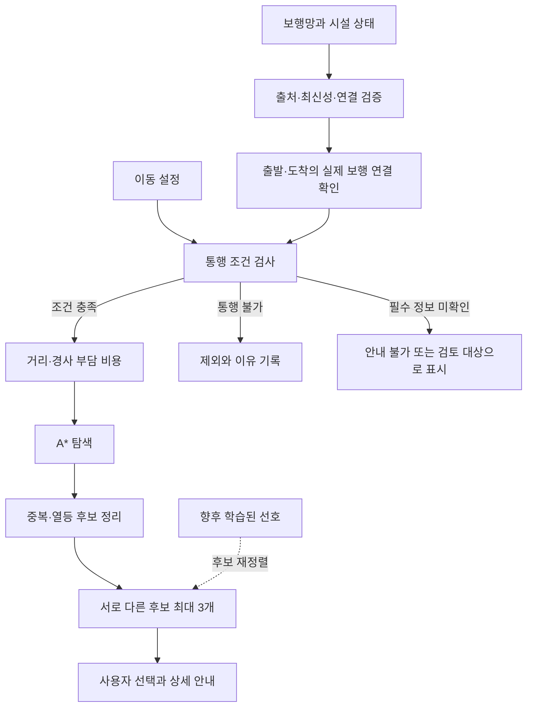

# 이동권 길찾기: 제약조건, 경로 탐색, 학습 모델 설계안

상태: 구현 기록을 포함한 검토판 v8. 2026-10-09 보행·버스·지하철 전체 여정과 프로필별 역내 동선을 핵심 개발 범위로 정정했다. 개봉동은 검증 사례이며 경로 엔진이나 서비스 기능의 범위가 아니다. 아래 설계 전체가 구현되거나 현장 안전 검증을 마쳤다는 의미는 아니다.

## 1. 권고와 판단 근거

첫 버전은 **사용자별 통행 제약 + 다중 속성 비용을 사용하는 A* + 최대 3개의 설명 가능한 대안**으로 설계한다. 기존 Dijkstra는 정확도 비교 기준으로 유지한다. 머신러닝은 데이터가 쌓인 뒤 통행 가능한 후보의 선호 순서를 개선하는 데 적용한다.

| 접근 | 얻는 것 | 부담과 한계 | 권고 |
| --- | --- | --- | --- |
| 명시적 제약과 비용을 사용하는 탐색 | 제외 이유와 추천 이유를 설명하고 동일 입력을 재현할 수 있음 | 정확한 보행 연결·시설 자료가 필요하고 비용 계수는 검증해야 함 | 첫 버전 |
| 탐색 + 학습된 선호 비용 | 개인별 거리·경사 부담 차이를 반영할 수 있음 | 동의받은 이용 결과와 편향·오류 검증 필요 | 비교 데이터가 확보된 다음 단계 |
| 모델이 경로 전체를 직접 생성 | 복잡한 행동을 학습할 가능성 | 현재 학습·검증 자료가 없고 통행 제약 준수를 별도로 보장해야 함 | 현재 채택하지 않음 |

현재 `Core/Router.swift`는 A*와 비교용 Dijkstra(`useHeuristic: false`)를 구현했다. 전체·부분 링크의 실제 비용/직선거리 비율로 휴리스틱 하한을 조정하고 하한이 0이면 Dijkstra가 된다. 휠체어의 계단·에스컬레이터·미확인 경사 제외, 명시적 역방향 허용, 링크 중간 출발·도착, 거리와 추정 시간의 누적을 검증했다. 빠른 경로는 평지 속도와 확인된 경사의 공학적 시간 추정을 비용으로 사용한다. 계수 보정과 신호·시설 대기는 아직 포함하지 않는다.

서울시 공식 CSV 원본 491,082건에서 변환한 노드 212,066개·링크 263,264개는 `.private/`에 보관한다. 앱의 일반 보행 연결은 2026-09-27자 한국 OSM 원자료에서 서울·광명시 범위의 노드 285,684개·링크 361,221개를 추출해 교체했다. 두 출처를 결합하거나 임의 연결을 만들지 않았다. OSM에도 보도 실측 경사·턱·폭의 확인값은 없고 현장 확인 표가 비어 있어 실제 휠체어 경로는 제외한다. 역내 단계도 여전히 비어 있다. 합성 그래프 검증과 실제 도로·시설 검증은 별개의 완료 조건이다.

기존 서울시 자료에서는 시청→종각, 홍대→합정, 강남→역삼, 서울숲→건대 네 구간 모두 단절됐다. 예를 들어 시청의 선택 노드 `5953`은 69,104개 노드 요소, 종각의 `86876`은 11,964개 노드 요소에 속했다. OSM으로 교체한 뒤 후자 세 구간은 A*와 Dijkstra가 같은 비용으로 연결했다. 시청→종각은 종각 검색 중심의 가장 가까운 14m 보행 구간이 16개 노드의 고립 요소이고 큰 보행망은 약 32.5m 떨어져 여전히 실패한다. 확인되지 않은 출입구 연결을 자동 생성하지 않는다. 이 상태를 서울 전역 길찾기 완료로 보지 않는다.

## 2. 제공된 논문에서 적용할 내용

[교통약자 이동불편지수 산정을 통한 경로추천 방법 설계 및 구현, 2021](https://www.jkst.or.kr/articles/xml/PwVy/)은 기존 길찾기 서비스에서 후보를 수집하고, 이용할 수 없는 시설이 포함된 경로를 제거한 뒤 유형별 이동불편지수로 순서를 조정한다. 이 논문이 검증한 것은 A* 탐색 자체가 아니다.

앱에 적용할 원칙은 다음과 같다.

- 한 구간이라도 필수 통행 조건을 만족하지 못하면 전체 경로를 추천에서 제외한다.
- 통행 가능한 후보에 한해 이동 부담을 비교한다.
- 시설의 존재뿐 아니라 출입구·이동통로·승강장까지 이어지는 연결을 확인한다.
- 장애 유형별 평균값을 개인의 능력과 동일시하지 않는다. 사용자가 실제 이동 조건을 조정한다.

논문의 설문 기반 가중치, 시간 구간 점수와 시설 연결성 표현을 현재 서비스의 확정 계수로 복사하지 않는다. 보행 환경과 개인별 이동시간 보정은 논문에서도 후속 개선 대상으로 남아 있다. 앱의 경사·보도 폭·턱 기준은 별도 데이터와 현장 검증으로 결정한다.

## 3. 지역에 종속되지 않는 서비스와 검증 범위

서비스는 임의의 출발지와 목적지에 대해 장소 검색 → 목적지 선택 → 이동 설정 확인 → 경로 찾기 → 후보 비교 → 상세 안내를 같은 규칙으로 제공하도록 설계한다. 서울을 중심으로 자료 범위를 넓히며 지역을 추가할 때 핵심 경로 알고리즘이나 화면 흐름을 다시 만들지 않는다. 개봉역과 주변 보행 구역은 초기 자료·현장 검증 사례다.

지도·장소 검색 범위와 접근성 경로 제공 범위를 구분한다. 검색되는 장소라는 이유로 길찾기 가능 상태를 표시하지 않는다. 보행망 밖 목적지는 제공 범위와 실패 이유를 보여준다.

### 지역 확장 계약

- 경로 엔진의 입력은 출발·도착 위치와 검증된 연결 후보, 사용자 이동 조건, 보행 그래프와 시설 상태다. 특정 지역명·역명·고정 좌표를 통행 판단이나 탐색 조건으로 사용하지 않는다.
- 사용자가 지정한 임의의 출발지와 목적지를 지원한다. 현재 위치는 출발지를 정하는 한 방법이며 유일한 입력 방식으로 강제하지 않는다. 일반 장소까지의 보행 경로에 특정 역이나 엘리베이터 자료를 요구하지 않는다.
- 수집 도구의 구역·역 선택은 명시적 입력으로 받는다. 구역 정보가 없을 때 구로구로 간주하거나 모든 엘리베이터를 개봉역 것으로 이름 붙이지 않는다. 원본별 좌표·필드 차이는 가져오기 단계에서 변환하고 경로 엔진은 공통 자료를 사용한다.
- 노드·링크·역·시설 ID에는 원본 제공기관과 자료 범위를 구분할 근거를 보존해 서로 다른 자료의 ID 충돌을 막는다. 지도 좌표가 같다는 이유만으로 시설이나 다른 층의 노드를 합치지 않는다.
- 행정구역 경계를 넘어가는 보행 링크와 실제 연결을 유지한다. 다른 지역의 자료를 추가한 뒤에도 담장·차도·층 차이·통행 방향을 확인한 연결만 사용한다. 경계에서 끊긴 자료는 경로 없음 또는 연결 자료 부족으로 설명한다.
- 역내 안내는 선택한 역·출입구·층·승강장과 연결된 동선에만 적용한다. 역명이나 기관을 바꿔도 같은 선택·검증 절차를 사용한다.
- 결과는 경로 후보뿐 아니라 제공 범위 밖, 연결 자료 부족, 필수 접근 조건 미확인, 조건을 만족하는 경로 없음의 이유를 구분한다. 데이터가 부족한 지역도 같은 요청·응답 흐름으로 처리한다.

### 현재 구현에서 바꿀 지역 고정 부분

2026-09-25 코드 확인 결과, `Tools/import_seoul.py`에는 구로구 필터·개봉역 선택·개봉역 엘리베이터 필수 조건이 있다. `App/ContentView.swift`에는 개봉역 좌표·시범 목적지·역내 안내 문구와 `isPilotStation` 분기가 남아 있다. 구현 단계에서 위 입력·시설 연결 규칙으로 교체한다. 특정 좌표를 기본 화면 예시로 쓰는 것과 경로 가능 여부를 그 좌표·역에 종속시키는 것은 구분한다. 아직 현재 구현이 모든 지역에서 동작한다고 주장하지 않는다.

일반 보행, 휠체어, 보행 보조 등의 항목은 설정 시작점으로 사용한다. 실제 계산은 다음의 기능적 조건을 따른다.

- 계단과 에스컬레이터 이용 가능 여부
- 사용자가 수용하는 오르막·내리막 한계
- 필요한 통과 폭, 넘을 수 있는 턱 등 현장 자료로 검사할 수 있는 조건
- 거리와 경사 부담 중 우선순위

첫 화면은 간단한 프리셋과 경사·계단 설정을 보여준다. 추가 수치는 신뢰할 수 있는 데이터와 이용자 검증이 갖춰졌을 때 상세 설정에 노출한다. 확인되지 않은 신체 능력을 장애명으로 추정하지 않는다.

## 4. 경로 계산 흐름

모델의 출력은 통행 제약을 해제할 수 없다. 시설 폐쇄가 확인되면 모든 가중치와 사용자 프리셋에서 해당 구간을 제외한다.

### 통행 상태

필수 속성은 `충족 / 위반 / 미확인`으로 검사한다. 정보가 없다는 이유로 `턱 없음`, `경사 0`, `엘리베이터 정상`을 부여하지 않는다.

휠체어 안내에서 계단, 에스컬레이터, 폐쇄 시설, 사용자 한계를 넘는 실측 경사는 통행 불가다. 필수 속성이 미확인인 경로는 기본 안내에서 제외한다. 검토용 경로를 별도로 보여주더라도 현장 확인이 필요한 자료로 표시하고 접근 가능한 경로처럼 안내를 시작하지 않는다. 조건을 충족하는 경로가 없으면 그 결과를 그대로 알린다.

현재 코드의 ‘미확인 경사도 경로에 넣고 점선 표시’는 개발용 탐색 수준이다. 실제 안내 모드로 전환하려면 위 정책과 자료 확보가 먼저 필요하다.

검사할 조건은 프리셋 이름이 아니라 사용자가 확인한 유효 설정으로 결정한다. 다음 표는 초기 정책안이다. 개인 수치의 기본값은 이용자와 현장 평가를 거친 정책 버전으로 관리하며, 현재 코드의 경사 숫자를 보편적인 안전 한계로 확정하지 않는다.

| 검사 항목 | 휠체어 | 보행 보조·계단 회피 | 일반 보행 |
| --- | --- | --- | --- |
| 실제 보행 연결·통행 방향·폐쇄 | 필수 | 필수 | 필수 |
| 계단·에스컬레이터 | 제외 | 기본 제외, 실제 설정 확인 | 허용 설정과 운영 상태에 따름 |
| 오르막·내리막 경사 | 방향별 한계 검사 필수 | 지정된 한계 검사 | 한계를 지정한 경우 검사 |
| 유효 폭·턱·횡경사·노면 | 시범 정책 및 기기 조건에 따른 검사 필수 | 보조기기·선택 조건에 해당하는 항목 검사 | 선택 조건에 해당하는 항목 검사 |
| 이동에 사용하는 엘리베이터 | 연결과 운영 정보 필수 | 연결과 운영 정보 필수 | 연결과 운영 정보 필수 |

조건 검사에 필요한 속성이 없거나 출처의 유효성을 잃으면 `미확인`이다. 측정 오차 범위가 한계에 걸쳐 있으면 충족을 단정하지 않는다. 오차 정보가 없는 값을 오차 0으로 바꾸지 않으며, 한계 주변 구간은 측정 방법과 재확인 기준을 정해 검토한다. 사용자가 지도에서 위치를 고르는 행동은 경사·턱·시설 상태의 현장 검증을 대신하지 않는다.

### 비용과 A*

통행 조건을 통과한 각 링크에 비음수 비용을 부여한다. 초기 비용은 거리와 방향별 실측 경사 부담을 사용한다. 검증된 횡단·노면 자료가 생기면 해당 부담을 추가한다. 거리·시간·경사율을 단위 조정 없이 더하지 않는다.

`경로 비용 = 거리 비용 + 오르막 부담 + 내리막 부담 + 사용 가능한 추가 부담`

경사 부담 계수는 물리적인 통행 허용 한계와 별개다. 수동휠체어의 추진 부담, 내리막 제동 부담, 보행 보조 이용자의 부담을 동일하다고 가정하지 않는다. 첫 계수는 검증할 공학적 가정으로 기록하고 현장 평가 전 안전 기준으로 홍보하지 않는다.

한 링크에 급경사 일부가 섞이면 평균 경사로 통행 조건을 검사하지 않는다. 경사가 바뀌는 위치에서 측정 구간을 나누고, 각 방향의 국소 최대 경사로 한계를 검사한다. 경사 부담 비용은 구간 길이에 따른 누적값으로 계산한다. 화면의 ‘경사 부담 우선’도 누적 부담을 뜻하며, 최대 경사가 가장 작은 경로라는 의미로 사용하지 않는다.

A*는 `f = 누적 비용 g + 남은 비용의 하한 h`로 탐색한다. 직선거리에 최소 단위 비용을 곱한 값을 하한으로 쓸 수 있는지 링크 길이와 비용 정의를 검사한다. 하한 조건을 보장할 수 없으면 `h = 0`을 사용한다. 같은 조건에서 Dijkstra와 최종 비용이 같아야 한다. 근거: [A* 원 논문](https://ai.stanford.edu/~nilsson/OnlinePubs-Nils/PublishedPapers/astar.pdf).

구현 시 지킬 계약은 다음과 같다.

- 링크 비용은 유한한 비음수이며, 같은 탐색 안에서 비용·프로필·그래프·시설 상태를 고정한다.
- 노드의 최선 기록에는 `g`를 저장하고 우선순위 큐에는 `g+h`를 사용한다. 오래된 큐 항목도 저장된 `g`와 비교해 거른다.
- `h(v)=α×거리(v,목적지)`를 쓰려면 모든 방향 링크에서 `c(u,v)≥α×거리(u,v)`가 성립해야 한다. 위·경도 거리 함수의 대칭성과 삼각부등식, 연결 링크의 비용까지 검사한다. 수치 오차를 포함해 조건이 성립하지 않으면 휴리스틱을 0으로 둔다.
- 복수의 검증된 목적지 출입구는 하나의 가상 목적지에 연결한다. 이때 휴리스틱은 각 출입구까지 거리 하한의 최솟값을 사용하고, 가상 목적지에서 0이다. 시설 연결·마지막 보행 구간 비용을 실제 후보 비용에 포함한다.
- 출입구 선택까지 동일한 비용함수를 유지한다. 경사 부담 기준으로 탐색한 결과를 마지막에 거리만으로 다시 고르지 않는다.
- 결과는 총비용과 물리 지표를 함께 갖는다. 최적 비용이 같은 경로는 서로 달라도 정답일 수 있으므로 Dijkstra 대조에서 링크 ID 일치만 요구하지 않는다.

여기서 가중치는 경로의 속성 비용에 적용한다. 속도 향상을 위해 휴리스틱을 증폭하는 Weighted A*는 별도 방식이며 첫 버전에 포함하지 않는다.

이 설계의 A*는 여러 속성을 하나의 비용으로 합친 탐색이다. 모든 절충안을 구하는 진정한 다목적 A*와는 제공 보장이 다르다. Pareto 탐색은 노드마다 여러 비지배 후보를 유지하며 해 집합이 크게 늘 수 있다. 첫 버전에서 다목적 최적해 전체를 계산한다고 주장하지 않는다. 근거: [BOA*](https://ojs.aaai.org/index.php/SOCS/article/view/18521), [근사 다목적 탐색 연구](https://ojs.aaai.org/index.php/SOCS/article/view/21768).

총 이동거리 상한, 배터리 잔량, 환승 누적 부담처럼 경로 전체 이력에 의존하는 제약을 추가할 때는 노드당 비용 하나만 저장하는 구조를 재검토한다. 해당 기능을 첫 보행 시범에 미리 넣지는 않는다.

### 대안 경로

같은 통행 제약을 고정하고 `거리 우선`, `경사 부담 우선`, `균형`의 비용 설정으로 후보를 생성한다. 후보의 링크·선형과 거리·경사 지표를 비교하여 중복과 다른 후보에 비해 어느 지표도 더 낫지 않고 하나 이상 나쁜 후보를 정리한다.

후보 정리는 같은 출발·도착 연결, 프로필, 자료 버전에서 산출한 원시 지표로 수행한다. 서로 다른 가중치로 계산한 총점을 후보 간 지배 관계 판정에 사용하지 않는다. 비교 화면에는 총거리, 최대 오르막·내리막, 누적 경사 부담과 시설 확인 시각을 제시한다. 검증되지 않은 ‘안전도 95%’ 같은 숫자는 만들지 않는다. 실제로 대부분 같은 길인 후보는 링크 중첩과 차이가 나는 구간을 확인해 통합하고, 중첩률 기준은 시범 결과에서 조정한다.

서로 다른 후보가 있으면 최대 3개를 제시한다. 하나만 있으면 하나만 보여준다. 후보 수를 맞추려고 계단이나 미확인 구간을 허용하지 않는다. 여러 비용 설정으로 탐색하는 방식은 모든 Pareto 경로나 k번째 최단경로를 보장하지 않는다.

가중합이 유용한 절충안을 놓치는 사례가 현장 평가에서 반복되면 2개 목적의 Pareto 탐색을 비교한다. 동일 비용에서 우회 대안 자체가 필요한 경우에는 k개 경로 탐색을 별도로 비교한다. 사용자에게 보이는 후보 수만을 위해 먼저 추가하지 않는다.

## 5. 데이터와 공간 연결

| 자료 | 필수로 보존할 정보 | 잘못 처리하면 생기는 문제 |
| --- | --- | --- |
| 보행 링크 | 실제 선형, 양 끝 노드, 이동 방향, 길이, 층·높이 구분 | 길 건너편·육교 아래·다른 층을 연결할 수 있음 |
| 접근 조건 | 계단, 방향별 경사, 폭, 턱, 필요한 노면 정보와 각각의 확인 상태 | 하나의 ‘확인됨’ 표시가 미확인 속성까지 보장하게 됨 |
| 시설 연결 | 출입구→엘리베이터→대합실→승강장의 실제 연결 | 엘리베이터 위치만 보고 승강장 접근이 가능하다고 오인함 |
| 시설 운영 | 정상·고장·폐쇄·미확인 상태, 상태 확인 시각 | 설치되어 있지만 이용 불가능한 시설로 안내함 |
| 출처 | 제공기관·현장 확인일·추정/측정 구분·데이터 버전 | 오래된 자료나 모델 예측을 최신 실측으로 취급함 |

각 속성은 값·단위·적용 방향·측정 위치·근거 종류·관측 시각을 보존한다. `가져온 날짜`, `기관이 갱신한 날짜`, `현장에서 확인한 날짜`는 서로 다른 필드다. 하나의 `fieldChecked` 값으로 같은 링크의 다른 속성까지 확인됐다고 표시하지 않는다. 기존 `field_checks.csv`의 단일 경사·장애물 기록은 이 계약을 충족하도록 확장할 대상이다.

보행 링크에는 정방향·역방향 통행 여부를 따로 둔다. 역방향 경로를 자동 생성하지 않으며, 오르막과 내리막의 의미도 진행 방향에 맞게 바꾼다. 좌표가 같아도 층이 다르면 별개 노드이고, 층 사이 이동은 확인된 계단·엘리베이터 등의 연결로만 표현한다.

현재 위치와 목적지를 보행망에 연결할 때 거리만 검사하지 않는다. 35m 이내라도 차도·담장·건물·층 차이가 있으면 연결을 확정할 수 없다. 실제 출입구와 같은 보행면의 연결을 확인하고, 여러 링크가 가능하면 사용자가 지도에서 확인할 수 있게 한다. GPS 수평 정확도만으로 올바른 보도에 있다고 보장하지 않는다.

거리 범위는 연결 후보를 찾는 용도로만 사용한다. 실제 보행면·출입구를 정한 뒤 그 연결에도 동일한 통행 조건을 적용한다. 가까운 링크가 통행 불가라는 이유로 담장 너머의 다른 링크에 출발점을 옮기지 않는다. 연결이 확인된 링크 중간의 출발·도착점은 임시 노드로 나누고 원래 방향·속성·비용을 보존한다. 두 점이 같은 링크 위에 있는 경우에도 실제 부분 구간으로 연결한다.

사용자가 제공한 표고점·등고선은 지형 검토에 사용한다. 이 자료로 추정한 경사를 보도 실측 경사로 바꾸거나 턱·폭 정보를 생성하지 않는다. 학습 모델이 보도 높이를 추정하더라도 추정값과 실측값을 구분한다.

시설 상태의 유효기간은 실제 제공기관의 갱신 주기와 서비스 수준을 확인한 뒤 정책으로 정한다. 갱신 시각을 알 수 없는 응답을 실시간 정상 상태로 표시하지 않는다.

경로 계산에 사용한 자료 버전과 시설 관측 시각을 결과에 남긴다. 앞으로 지나갈 필수 시설의 폐쇄·고장이 확인되거나 유효성을 잃으면 해당 경로의 안내를 멈추고 재계산한다. 새 후보가 없으면 마지막 정상 결과를 계속 안내하지 않는다. 첫 시범은 검토된 자료 묶음과 명시적인 갱신으로 시작하며 실시간 스트리밍 시스템을 선행 구축하지 않는다.

## 6. 학습 모델을 적용할 순서

첫 학습 과제는 **조건을 충족한 후보 중 개인이 선호하는 경로를 예측하는 것**을 권고한다. 입력은 후보 거리, 방향별 경사 부담, 확인된 노면·횡단 정보, 사용자가 직접 선택한 이동 설정이다. 출력은 후보 선호 점수 또는 제한된 범위의 비용 가중치다.

첫 적용은 이미 검증한 후보의 재정렬로 제한한다. 이후 링크 비용까지 학습값을 반영한다면 비음수 비용과 A* 하한 조건을 다시 검증하고, 조건을 만족하지 않는 모델 출력에는 고정 비용으로 되돌아간다.

학습 자료는 동의받은 후보 선택, 이동 후 체감 부담과 중단 이유로 구성한다. 클릭이나 도착 기록만으로 통행 가능·안전을 정답 처리하지 않는다. 도착하지 못한 이유가 위치 오차인지, 불편인지, 일정 변경인지 구분되지 않는 기록은 안전 라벨로 쓰지 않는다.

선택 기록에는 당시 보여준 후보들의 속성과 표시 순서를 포함한다. 첫 번째로 노출됐다는 이유로 선택한 효과를 개인 선호로 오인하지 않도록 평가한다. 최단거리 기준뿐 아니라 사용자가 직접 조정한 고정 가중치도 비교 대상으로 둔다. 후보 선정과 순서 편향을 검토한 뒤 학습 모델의 개선을 주장한다.

모델은 해석 가능한 작은 회귀·선호 모델부터 기준선과 비교한다. 처음부터 대형 신경망, 강화학습 또는 자체 대규모 모델을 학습할 근거는 현재 없다. 모델 도입은 데이터와 평가 지표를 먼저 마련하고 단순한 기준선부터 비교하라는 [Google의 ML 개발 지침](https://developers.google.com/machine-learning/guides/rules-of-ml)과도 맞는다.

데이터의 일부를 같은 이용자·인접 보행 링크끼리 임의로 나누면 성능이 과대평가될 수 있다. 이용자·지역·시간을 분리한 평가를 하고, 고정 비용 기준보다 실제 선호와 체감 부담을 잘 설명하는지 확인한다. 필요한 표본 수는 희귀 장애요소 빈도와 학습곡선으로 판단하며 지금 임의로 정하지 않는다.

두 번째 후보는 보도 사진에서 계단·턱·경사로·공사 장애물을 찾는 모델이다. 사전학습 모델을 현장 자료로 보정하고 먼저 자료 검수 보조에 사용한다. 사진에서 계단이 검출되지 않았다는 이유만으로 계단이 없다고 판정하지 않는다. 모델의 통행 가능 오판, 지역·날씨·조명별 실패와 판단 보류 기능을 검증한 뒤 적용 범위를 넓힌다.

AR은 검증된 경로와 카메라 위치·방향 정합을 이용하는 표시 기능으로 별도 설계한다. 정확한 위치가 확보되지 않으면 화살표를 보행 방향으로 제시하지 않는다. 초기 AR은 지도 기반 길안내와 시설 인식 보조를 결합하는 단계로 두며, 독립적인 시각장애 보행 안전 시스템을 제공한다고 표시하지 않는다.

### 공유받은 경사로 지도 참고 (2026-09-28)

[SlopeMap FAQ](https://slopemap.kr/#faq)는 OpenStreetMap 보행로에 건물·수목 높이를 제거한 FABDEM의 30m 지면 고도를 적용하고, 경사를 30m 구간으로 계산한다고 설명한다. [제작자 개발 기록](https://jyos.tistory.com/39)은 약 12m 간격의 고도 샘플, 오르막 제곱 벌점과 A* 비교 경로를 소개한다. 이는 **지형 경사 추정과 경로 비용 설계의 참고 사례**다. 30m 고도는 보도 턱·낮은 계단·횡경사·실제 경사로 각도를 확인하지 못하므로 휠체어의 통과 허가 자료로 쓰지 않는다. 사이트 역시 FAQ에서 작은 턱·계단을 보장하지 않는다고 밝힌다.

제작자 기록의 계단 회피는 비용에 큰 벌점을 주어 막다른 길에서는 계단을 반환할 수 있다. 우리 휠체어 프로필의 계단·에스컬레이터 **절대 제외** 규칙에 그대로 채택할 수 없다. 오르막만 벌주는 비용 역시 휠체어의 내리막 제동 부담을 반영하지 못하므로 방향별 오르막·내리막을 유지한다.

SlopeMap이 쓰는 FABDEM에는 [비상업 조건(CC BY-NC 4.0)](https://data.bris.ac.uk/data/dataset/s5hqmjcdj8yo2ibzi9b4ew3sn)이 표시되어 있다. 지금은 이 서비스의 지도 데이터나 내부 API를 가져오지 않고 공개 설명만 참고한다. 추가 보행망을 선택하면 [OpenStreetMap의 별도 원자료와 표시 의무](https://www.openstreetmap.org/copyright)를 확인한 뒤 자체 그래프 입력으로 다룬다.

## 7. 보행·버스·지하철 전체 여정

2026-10-09 사용자 정정: 대중교통 연결은 핵심 개발 작업이다. 보행망 전체 복구를 끝낸 뒤에만 착수하는 확장 기능으로 취급하지 않는다. 임의의 출발지·목적지에서 보행, 버스, 지하철, 혼합 후보를 수집하고 프로필 제약을 적용한다. 거리만으로 한 수단을 강제하지 않고 전체 예상시간·총 보행량·연속 보행량·환승 부담을 비교한다. 후보를 최대 3개 보여주되 실제로 다른 이용 가능한 후보가 부족하면 개수를 꾸며 채우지 않는다.

전체 연결은 `출발지 → 정류장/접근 가능한 역 출입구 → 역내 이동 → 탑승 → 환승 → 하차·역 밖 이동 → 목적지`다. 휠체어에서는 출발역·환승역·도착역 모두 계단·에스컬레이터를 제외한 엘리베이터 동선을 확인한다. 걷기 힘든 사용자의 계단 회피와 에스컬레이터 사용 가능 여부는 별도 설정으로 다루며 보조기기 이름만으로 사용 가능성을 추정하지 않는다. 시설의 존재만으로 올바른 방향의 승강장까지 이어진다고 판정하지 않는다. 엘리베이터 고장·폐쇄가 확인되면 해당 동선을 제외하고 다른 역·환승·교통수단 후보를 재평가한다.

버스는 노선 전체를 저상으로 가정하지 않는다. 실제 탑승 후보 차량의 저상 여부, 승하차 정류장 연결과 접근성을 확인하고 미확인은 별도로 표시한다. 서울·경기 운영기관의 노선·정류장 ID를 제공기관별로 매핑한다. 공급자의 일반 경로 후보에 접근성 정보가 없으면 휠체어 이용 가능으로 승격하지 않으며, 미확인 참고 후보의 안내 시작 제한을 유지한다.

실외·역내 연결에 기존 A*를 재사용하고, 교통수단 간 후보는 운행·대기·환승 정보를 제공하는 API와 결합한다. 전체 예상시간은 개인 속도와 경사를 반영한 접속 이동시간, 역내 이동, 차량 이동, 제공된 대기시간과 환승시간으로 계산한다. 공급자의 보행시간을 자체 시간으로 교체할 때 이중 합산을 방지한다. 변경된 역 도착 시각이 차량 출발을 넘으면 해당 연결을 다시 계산한다. 시간표·대기정보가 없으면 실시간 도착으로 표시하지 않고 예상치의 범위를 설명한다.

현재 구현은 일반 보행에서 Apple 대중교통 ETA 비교와 외부 지도 열기까지만 지원한다. 앱 내부 버스·지하철 전체 여정이나 프로필별 시설 연결은 아직 구현하지 않았다. 개봉성당→서울역 본관은 검증 사례이며, 특정 역을 강제하는 분기는 만들지 않는다. 보행 자료 보강과 대중교통 후보 연결을 병행한다.

### 대중교통 후보 API와 추가 자료

2026-10-09 공식 명세 확인: [ODsay 대중교통 길찾기 v1.8](https://lab.odsay.com/guide/releaseReference?platform=web)의 `searchPubTransPathT`는 HTTPS GET/POST, 출발·도착 경위도 `SX/SY/EX/EY`, `SearchPathType=0`으로 지하철·버스·혼합 후보를 반환한다. `info.totalWalk`, `totalTime`, `subPath`를 비교·상세 단계에 사용할 후보로 검토한다. API 제공 결과를 실제 보도나 역내 접근성 근거로 사용하지 않는다. 제공사의 승인 범위·가공/표시 조건·요금·호출 한도를 확인한 뒤 연동하며, 아직 사용 서비스로 확정하거나 호출하지 않았다.

[ODsay 등록 가이드](https://lab.odsay.com/guide/guide?platform=web)에 서버 플랫폼과 IP 등록이 명시돼 있다. 키 발급이 가능하면 로컬 `.env`의 `ODSAY_API_KEY`에 보관하고, 앱에서는 보호된 HTTPS 중계를 호출한다. AWS 배포 전에 서버 키의 허용 출발 IP 조건과 배포 방식의 호환성을 확인한다. 앱 소스·번들에는 키를 포함하지 않는다. 제공사 데이터를 자체 공개 데이터베이스에 복제하지 않는다.

시설 연결은 기존 KRIC 출입구→승강장 및 환승 이동경로와 운영기관 엘리베이터/에스컬레이터 동선·상태 자료를 사용한다. 현재 공식 KRIC 상세 페이지 재조회는 실패했으므로 기존 서비스 주소·승인 범위와 실제 응답을 재검증해야 한다. 서울교통공사 자료만으로 코레일 등 다른 운영기관을 포함했다고 가정하지 않는다. 버스 실제 차량 도착 자료 후보는 [서울특별시_버스도착정보조회 서비스](https://www.data.go.kr/data/15000314/openapi.do)와 [경기도_버스도착정보 조회](https://www.data.go.kr/data/15080346/openapi.do)이며, 저상 필드·코드·HTTPS 주소·노선/정류장 매핑을 확인하기 전 인증키 호출이나 저상 판정을 하지 않는다.

서울 전체 지하철·버스 경로에는 출발 시각, 운행표, 환승 여유시간, 저상버스 실제 도착, 시설 운행 상태가 필요하다.

서울교통공사 [최단경로이동정보 `getShtrmPath`](https://data.seoul.go.kr/dataList/OA-22724/A/1/datasetView.do)는 **역 사이 열차 경로 후보**에 쓴다. 필수 입력은 출발역명 `dptreStnNm`, 도착역명 `arvlStnNm`, 기준일시 `searchDt`(`yyyy-MM-dd hh:mm:ss`)와 공통 API 키·출력 형식·조회 범위다. 선택 입력 `searchType`은 `duration`(기본 최소시간), `distance`(최단거리), `transfer`(최소환승)이며 경유역·환승 제외역·시간표 포함 여부를 지정할 수 있다. 공개 샘플의 JSON은 `header.resultCode=00`, `body.paths`의 구간별 출발·도착역, 거리, 소요·대기시간, 환승 여부 등을 반환했다. 이 응답에는 출입구에서 승강장까지의 층별 이동 경로나 휠체어 통행 가능 판정이 없다. 열차 후보마다 출발·환승·도착역의 실제 접근 가능한 연결과 당시 시설 운영 상태를 별도로 확인한다. `최단` 결과를 이용자에게 곧바로 접근 가능한 경로로 표시하지 않는다.

서울교통공사 [교통약자 에스컬레이터 `getWksnEsctr`](https://data.seoul.go.kr/dataList/OA-22742/A/1/datasetView.do)는 **역 시설 연결 및 상태 자료**로 쓴다. 공통 API 키·출력 형식·조회 범위 외에 호선 `lineNm`, 역코드 `stnCd`(일치), 역명 `stnNm`, 근접 출입구 `vcntEntrcNo`, 가동 상태 `oprtngSitu` 등으로 조회한다. 공식 명세의 상태 코드는 `M=사용가능`, `D=삭제`, `S=보수중`, `T=중지`, `I=점검중`, `B=공사중`이다. 공개 샘플의 JSON은 `response.header.resultCode=00`, `response.body.items.item`에 역·시설 ID, 시작/종료 층과 상세 위치, 근접 출입구, 상태, 기준일자 `crtrYmd`를 포함했다. `crtrYmd`는 날짜 필드이므로 포털의 실시간 갱신 설명만으로 각 시설의 분 단위 관측 시각을 확정하지 않는다. 휠체어 설정에서는 상태가 `M`이어도 에스컬레이터를 경로에서 제외한다. 이용 가능한 설정이라도 실제 동선 연결과 운영 상태를 확인한 경우에만 포함한다.

두 API는 서울교통공사 제공 범위를 먼저 확인하고 역코드·시설 ID를 다른 운영기관의 자료와 혼합하지 않는다. 지역에 독립적인 경로 엔진에는 검증된 열차 후보와 시설 상태를 공통 형식으로 전달한다. 현재 프로젝트에는 두 API의 실제 키 호출이나 앱 연결이 없으며, 공개 샘플 성공을 발급 키 인증 성공으로 해석하지 않는다.

두 공식 명세의 예시 호출 주소는 키를 URL 경로에 넣는 HTTP다. 앞선 보행망 API 점검에서 서울시 Open API 호스트의 HTTPS 연결이 성립하지 않았다. 이 상태에서는 로컬 `.env` 키를 두 서비스의 HTTP 주소로 보내지 않는다. 공식 HTTPS 호출 주소나 키가 노출되지 않는 공식 제공 방식이 확인될 때 실제 키의 적용 범위를 시험한다. 앱 번들에 키를 포함하지 않고, 향후 키 호출은 보호된 서버 경계에서만 수행한다.

전체 여정을 정적인 보행 링크 비용으로 계산하지 않는다. 대중교통 후보 제공 API를 접근성 검증 후 평가하는 방식과 시간표 기반 자체 탐색을 데이터·약관·갱신 비용으로 비교한다. 자체 시간표 탐색 시 RAPTOR 계열은 도착 시각과 환승 횟수를 함께 다루는 비교 대상이다. 첫 보행 시범에서 확정 엔진으로 선정하지 않는다. 근거: [Round-Based Public Transit Routing](https://www.microsoft.com/en-us/research/publication/round-based-public-transit-routing/).

## 8. 화면과 개인정보

- 지도 중심 화면과 아래 패널을 유지한다. 장소 검색, 목적지 확인, 경로 후보, 상세 안내에서 이전 단계로 돌아가는 버튼을 제공한다.
- 목적지를 고르면 자동 안내를 시작하지 않는다. `경로 찾기` 후 후보와 제외 이유를 확인하고 경로를 선택한다.
- 상세 안내에는 실제 확인된 진입점·회전·횡단·시설 이용·도착 지점을 보여준다. 링크 선형의 굴곡을 모두 교차로 회전으로 취급하지 않는다.
- 큰 글씨·VoiceOver·44pt 이상 조작 영역·색상 이외의 상태 표시를 기본으로 한다. 사용자 위치가 불확실해지면 안내 중지 이유와 다시 확인할 행동을 알린다.
- 진단명은 기본 수집하지 않는다. 이동 설정은 기본적으로 기기 안에서 관리하고 삭제할 수 있게 한다. 학습을 위한 이용 기록 수집은 별도 선택이며 거부해도 기본 길찾기를 사용할 수 있다.
- 서비스 비밀키는 수집 도구나 서버의 `.env`에 두고 `.gitignore`로 제외한다. `.env`를 사용해도 앱 번들에 키를 넣으면 추출될 수 있으므로 비밀키를 iOS 앱에 포함하지 않는다.
- 장소 검색어가 Apple 지도 서비스로 전달된다는 점과 선택적 학습 기록의 범위를 구분해 안내한다.

첫 시범은 계정 없이 운영하고 검색어·원시 위치 이력·진단명을 앱 로그나 학습 저장소에 보관하지 않는다. 위치와 검색 결과는 현재 작업에 필요한 메모리에서만 사용한다. 저장할 이동 설정은 초기화 기능을 제공하고, 파일·백업·오류 로그에서의 노출 범위를 구현 전에 확인한다.

학습 데이터 수집 기능을 추가할 때 수집 항목·보관 기간·동의 철회와 삭제 범위를 먼저 확정한다. 초기 후보는 경로 속성과 평가 응답이며, 원시 좌표·장소명·사진 수집은 별도 필요성과 동의를 검토한다. 이 정책이 확정되기 전에는 자동 학습 기록을 켜지 않는다.

## 9. 검증과 다음 작업 순서

### 우선순위

| 순서 | 작업 | 완료 판단 |
| --- | --- | --- |
| 1 | 프로필별 제약, 미확인 처리, 방향별 비용, 출발·도착 연결 계약 확정 | 같은 입력에서 허용·제외 이유와 비용을 재현할 수 있음 |
| 2A | 작은 검증용 그래프로 제약 필터와 A* 검증 | 아래 사례를 통과하고 같은 비용의 Dijkstra 결과와 일치 |
| 2B | 실제 보행망·시설 동선·접근 조건 확보 | 출처·속성·조사일·시범 구역 포함 여부와 누락 항목을 확인 |
| 2C | 보행·버스·지하철 후보와 프로필별 역내 연결을 병행 구현 | 임의의 출발·도착에서 전체 단계·예상시간·보행량을 표시하고 휠체어의 계단·에스컬레이터를 제외함; 키·실제 자료 미확보는 명시 |
| 3 | 검증된 한 구역에서 실제 경로 대조 | 연결·경사·턱·폭·시설 상태와 안내 지점을 현장 기록과 대조 |
| 4 | 지도에서 후보 비교와 상세 안내 연결 | 장소 검색부터 뒤로 가기·경로 선택·실패 설명까지 동작 |
| 5 | 경로선 애니메이션, 학습 모델, AR 각각 검토 | 경로와 데이터 검증 이후 필요성과 효과를 따로 평가 |

2A·2B·2C는 병행한다. 검증용 그래프는 실제 장소의 통행 가능 근거로 사용하지 않는다. 현재 보행 핵심 탐색과 지도 화면 연결을 구현했으며 대중교통 전체 여정과 실제 자료·현장 대조를 계속해야 한다. 학습 모델·영상·AR 구현은 경로·자료 검증 이후의 작업이다.

### 알고리즘 검증 사례

아래 숫자는 계산 검증용 가상 비용이며 실제 거리나 개인의 안전 한계를 뜻하지 않는다. 별도 테스트 프레임워크를 도입하지 않고 기존 `Tests/main.swift`의 실행 경로를 활용한다.

| 사례 | 입력 조건 | 기대 결과 |
| --- | --- | --- |
| 계단 회피 | 비용 2의 계단 경로와 비용 5의 조건 충족 경로 | 휠체어 설정에서는 비용 5 경로, 계단 경로 제외 이유 기록 |
| 방향별 경사 | 같은 구간의 정방향은 오르막 한계 이내, 역방향은 내리막 한계 초과 | 두 방향을 따로 검사하고 역방향 제외 |
| 국소 급경사 | 평균은 한계 이내이나 일부 측정 구간이 한계 초과 | 전체 링크를 허용하지 않고 해당 구간 제외 |
| 필수 자료 미확인 | 가장 짧은 길의 턱 또는 필수 경사 자료 누락 | 안내 후보 제외; 경로가 없으면 자료 부족 이유 표시 |
| 공간 연결 오류 | 가까운 두 점 사이에 담장·차도·층 차이 존재 | 거리만으로 출발·도착 연결을 만들지 않음 |
| 같은 링크의 두 점 | 출발과 도착이 동일한 검증 링크 중간에 존재 | 방향을 유지한 실제 부분 구간 비용 사용 |
| 출입구 선택 | 출입구 A는 거리 10·선택 비용 20, B는 거리 12·선택 비용 15 | 마지막 연결 비용까지 포함해 B 선택 |
| 최적 비용 | 같은 그래프·프로필·비용·자료 시점으로 A*와 Dijkstra 실행 | 허용 오차 내 최종 비용 일치; 동률 경로의 링크 일치는 요구하지 않음 |
| 잘못된 비용·하한 | 음수·NaN·무한 비용, 또는 휴리스틱 하한 불충족 | 잘못된 비용 자료는 입력 오류; 유효 비용에서 하한만 보장되지 않으면 h=0 |
| 중복 후보 | 세 비용 설정이 모두 같은 경로를 반환 | 경로 하나만 제시 |
| 시설 상태 변경 | 계산 후 앞으로 이용할 엘리베이터의 고장 확인 | 안내 중단·재탐색; 대안이 없으면 이전 경로를 계속 안내하지 않음 |
| 다른 지역·일반 목적지 | 개봉동 외 별도 그래프, 임의 출발지·일반 장소 목적지, 역 시설 없음 | 동일한 제약·비용으로 보행 경로 계산; 개봉역 자료를 요구하지 않음 |
| 지역 경계와 ID 충돌 | 서로 다른 원본에서 같은 지역 내 ID 사용, 경계를 넘는 검증된 보행 링크 존재 | 관련 없는 노드는 합치지 않고 확인된 경계 연결을 통해 경로 계산 |
| 다른 역의 상세 안내 | 서로 다른 두 역의 출입구·시설·동선 자료 | 선택한 역·출입구·승강장에 연결된 안내만 반환 |

실제 이용자와 경로를 검토하고 경사 방향, 턱, 폭, 출입구, 시설 운영 상태 및 상세 안내 지점을 대조한다. 검사에서 위반이 없었다는 사실을 현실의 무위험 보장으로 확대하지 않는다. 후보의 차이와 선택 이유, 계산 지연, 경로 미제공률과 그 원인을 측정한다. 데이터 부족으로 인한 미제공을 알고리즘 실패와 구분한다.

동의받은 선택·체감 부담 자료가 확보되면 선호 모델을 고정 비용과 비교한다. 모델이 개선한 범위와 실패한 이용 조건을 기록한 뒤 도입 여부를 결정한다. 대중교통 전체 여정은 보행·시설 자료 보강과 병행하며, AR은 실제 경로와 시설 연결을 검증한 범위에서 별도로 검토한다.

당장 필요한 외부 자료는 보행 네트워크, 실제 접근 가능한 역 출입구와 층별 연결, 시설 운영 정보, 보도 경사·턱·폭의 현장 기록이다. 계정이나 유료 API 계약은 제공 범위·이용 조건을 확인해 결정하며, 이 설계만으로 구매나 키 발급을 요구하지 않는다.

## 10. 자료 확보 목록

### 현재 폴더에서 확인한 자료

2026-09-25 파일 및 SHP/DBF 헤더 확인 기준이다. 원본의 전체 도형 품질과 현장 일치 여부까지 검증한 상태는 아니다.

| 보유 자료 | 확인 결과 | 사용 범위 |
| --- | --- | --- |
| `서울시 경사도/표고 5000/N3P_F002.shp` | Point, 76,580개 레코드, `HEIGHT` 필드 | 표고점 자료; 보행로 경사율 실측 자료로 취급하지 않음 |
| `서울시 경사도/등고선 5000/N3L_F001.shp` | PolyLine, 13,704개 레코드, `HEIGHT`·`SHAPE_LEN` 필드 | 지형 검토·추정 경사의 근거 후보; 턱·폭·실제 보행 연결은 별도 필요 |
| `서울시 등고선/표고 5000/N3P_F002.shp` | Point, 45,870개 레코드, `HEIGHT` 필드 | 위 표고점 파일과 범위가 다른 지형 자료 |
| `서울시 등고선/등고선 5000/N3L_F001.shp` | PolyLine, 8,570개 레코드, `HEIGHT`·`SHAPE_LEN` 필드 | 위 등고선 파일과 범위가 다른 지형 자료 |
| `Data/network.json` (2026-09-25 당시) | 노드·링크·출입구 각 0개 | 이후 OSM 보행망으로 교체; 현재 상태는 위 1절 참조 |
| `Data/station_steps.json` | 역내 경로 0개 | 실제 역내 동선 미확보 |
| `Data/field_checks.csv` | 헤더만 존재 | 현장 검증 기록 미확보 |

네 SHP에 `.shx`·`.dbf`·`.prj`·`.shp.xml`이 동봉돼 있다. `.prj`에는 `Korean_1985_Modified_Korea_Central_Belt`와 미터 단위가 기록돼 있다. 이번 목록 확인에서 좌표 변환이나 시범 구역 포함 여부를 재검증하지는 않았다. 네 파일의 DBF에는 보행로별 경사율·턱·통과 폭 필드가 없다.

### 공개자료 후보

공식 페이지 확인일: 2026-09-25. 아래 공개 자료는 제공 설명을 확인한 후보이며, 실제 원본 내려받기·대상 구역 레코드·응답 필드 검증이 완료됐다는 뜻은 아니다.

| 자료 | 확인한 출처와 범위 | 다음 확인 사항 |
| --- | --- | --- |
| 보행 노드·링크 | [서울시 자치구별 도보 네트워크 공간정보](https://data.seoul.go.kr/dataList/OA-21208/A/1/datasetView.do), WGS84 노드·링크, 설명상 2020년 기준 | 전체 CSV와 유형 코드표 확보, 시범 구역 연결·방향·층·횡단 정보 검사 |
| 역 주변 엘리베이터 위치 | [서울시 지하철역 엘리베이터 위치정보](https://data.seoul.go.kr/dataList/OA-21212/A/1/datasetView.do), 설명상 2020년 기준 | 대상 역 포함 여부, 시설 ID와 보행망·역내 동선의 연결 확인; 위치만으로 승강장 접근을 확정하지 않음 |
| 엘리베이터 운영 상태 | [서울교통공사 승강기 가동현황](https://data.seoul.go.kr/dataList/OA-15994/S/1/datasetView.do), 공사 각 역의 승강기 상태, 메타정보상 매시 갱신 | 대상 운영기관·역 포함 여부와 시설 ID 매핑, 응답의 실제 상태 시각 확인; 개봉역 등 다른 운영기관까지 포함한다고 가정하지 않음 |
| 역 사이 열차 경로 후보 | [서울교통공사 최단경로이동정보](https://data.seoul.go.kr/dataList/OA-22724/A/1/datasetView.do), `getShtrmPath`, 출발·도착역과 기준일시로 최소시간·최단거리·최소환승 후보 조회 | 출발·환승·도착역의 접근 가능한 출입구·승강장 연결은 별도 검증 |
| 역내 에스컬레이터 시설 | [서울교통공사 교통약자 에스컬레이터](https://data.seoul.go.kr/dataList/OA-22742/A/1/datasetView.do), `getWksnEsctr`, 역·출입구·층·가동 상태 | 휠체어에는 제외, 다른 설정에서는 시설 연결과 상태 기준일 확인 |
| 역 출입구부터 승강장까지의 동선 | 기존 프로젝트의 KRIC 연계 후보와 운영기관 동선도 | 실제 응답·출입구·층·엘리베이터 연결·방향별 승강장 확인; 공식 페이지 접속 확인만으로 확보 처리하지 않음 |
| 보도 접근 조건 | 구간별 실측 경사·유효 폭·턱·횡경사·노면·폐쇄 기록 | 공개자료에 해당 필드가 있는지 먼저 확인하고 빠진 필수 속성만 현장 조사 대상으로 정함 |

서울 보행망과 엘리베이터 위치 자료의 포털 갱신일이 최근이어도 설명의 2020년 기준과 구분한다. 데이터 제공기관의 갱신 주기를 각 시설의 현장 관측 시각으로 복사하지 않는다. 자료별 원본·다운로드 시각·출처·이용 조건·필드 설명을 함께 보존한다.

### 사용자에게 요청할 자료와 진행 방식

- 공개 보행망·시설 자료는 먼저 직접 확보 가능 여부를 확인한다. 인증이나 사용자의 다운로드가 실제로 필요한 경우 해당 서비스와 파일명을 특정해 요청한다.
- 이미 제공한 GIS 자료에 동봉되지 않은 원본 다운로드 주소·제작 시점·좌표계/정확도 설명서가 있다면 추가 근거로 받는다. 원본 파일을 중복 요청하지 않는다.
- 현장 기록은 구간 위치, 진행 방향, 관측 항목, 값과 단위, 측정 방법, 확인 날짜를 함께 받는다. 사진만으로 정밀 경사나 통과 폭을 실측값으로 만들지 않는다.
- API 키가 필요해지면 등록할 환경변수 이름과 발급 서비스를 안내한다. 키는 로컬 `.env`에만 입력하고 채팅·공유 문서·앱 번들에 넣지 않는다.
- 자료가 부족한 동안에는 합성 그래프로 알고리즘을 검증하고 실제 안내 제공 범위는 검증된 보행 구역으로 한정한다.
